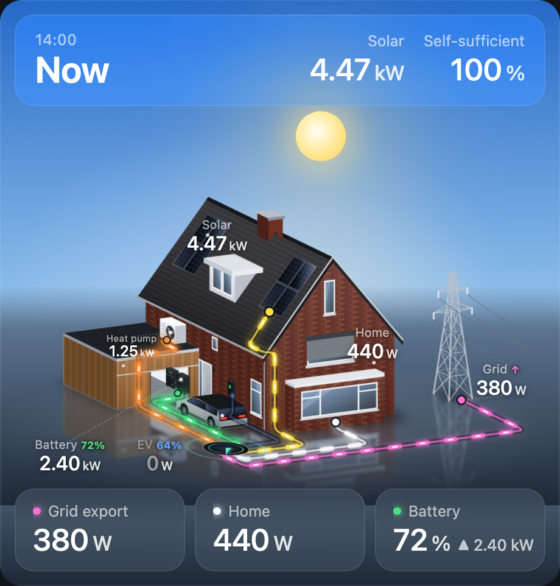
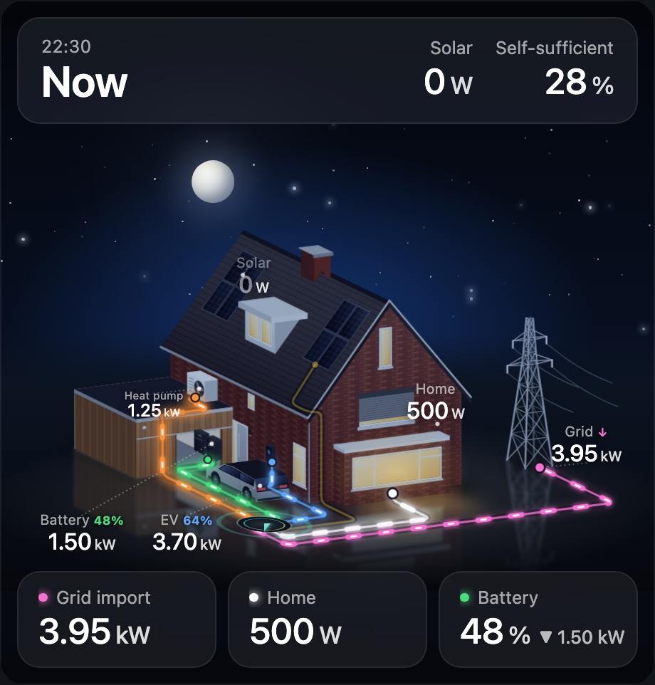

# House Energy Flow

[](https://hacs.xyz/docs/faq/custom_repositories/)
[](https://github.com/michielvgrootel/hass-house-energy-flow/actions/workflows/validate.yml)

An animated Home Assistant dashboard card that shows your home as a 3D model: a brick house with solar panels on the roof, a garage with the home battery inside and a heat pump on its roof, an EV at the wall charger, and a transmission tower for the grid. Glowing power lines run across the floor and pulse in the direction energy is flowing. The backdrop, sun, moon, stars and house lighting follow the real time of day.

| Day | Night |
|---|---|
|  |  |

- Every line pulses while power flows. The animation runs faster at higher power and reverses for export and battery discharge.
- The day/night cycle uses the elevation from `sun.sun`. At night the living-room window lights up and spills light onto the floor.
- Tap any device, label or stat to open its more-info dialog.
- No dependencies. It's a single JS file and works in both the masonry and sections dashboards.

## Install

### HACS (recommended)

1. In Home Assistant, open **HACS**, then **⋮ → Custom repositories**.
2. Add `https://github.com/michielvgrootel/hass-house-energy-flow` with type **Dashboard**.
3. Search for **House Energy Flow**, open it and click **Download**.
4. Reload the browser, then add a card of type `custom:home-energy-scene-card`.

HACS registers the dashboard resource for you. If you installed the card manually before, remove the old `/local/home-energy-scene-card.js` resource under **Settings → Dashboards → ⋮ → Resources**.

### Manual

1. Copy `home-energy-scene-card.js` to `<config>/www/home-energy-scene-card.js`.
2. Go to **Settings → Dashboards → ⋮ → Resources → Add resource**:
   - URL: `/local/home-energy-scene-card.js?v=3.3.2`
   - Type: **JavaScript module**
3. Refresh the browser (hard refresh), then add a card of type `custom:home-energy-scene-card`.

Home Assistant caches files under `/local/`, so raise the `?v=` number each time you replace the file.

## Configuration

```yaml
type: custom:home-energy-scene-card
title: Vandaag              # optional, default "Now" / "Nu"
subtitle: Westerstraat 187  # optional, default is the current time
language: nl                # optional: en | nl (default follows HA language)
entities:
  solar: sensor.solar_power            # W or kW, positive = producing
  grid: sensor.grid_power              # positive = import, negative = export
  battery: sensor.battery_power        # positive = charging, negative = discharging
  battery_soc: sensor.battery_soc      # %
  ev: sensor.ev_charger_power          # positive = charging
  ev_soc: sensor.ev_battery_level      # optional %
  heatpump: sensor.heat_pump_power
  home: sensor.house_consumption       # optional, computed from the others if omitted
```

If one of your sensors uses the opposite sign convention, use the object form with `invert`:

```yaml
entities:
  battery:
    entity: sensor.battery_power
    invert: true
```

### All options

| Option | Default | Description |
|---|---|---|
| `entities` | — | See above. Any device you leave out has no line or badge. |
| `title` / `subtitle` | `Now` / clock | Header text. |
| `language` | HA language | `en` or `nl`. Override single words with `labels:` (keys: `now, solar, self, grid, import, export, home, battery, ev, heatpump`). |
| `header_stats` | `[solar, self_sufficiency]` | Stats at the top. |
| `footer_stats` | `[grid, home, battery]` | Stats at the bottom. |
| `threshold` | `10` | Watts below which a line counts as idle. |
| `sun_entity` | `sun.sun` | Drives the day/night cycle. Falls back to local time if missing. |
| `colors` | — | Line colors, e.g. `colors: { grid: '#f472d0', solar: '#fde047' }`. |
| `demo_cycle` | — | Seconds per simulated day, e.g. `60`, for showing off the cycle. |

Stats can be built-in keys (`solar`, `grid`, `home`, `battery`, `ev`, `heatpump`, `self_sufficiency`) or any entity, which is useful for daily energy totals:

```yaml
header_stats:
  - entity: sensor.solar_energy_today
    name: Opwek
    decimals: 1
  - self_sufficiency
footer_stats:
  - entity: sensor.grid_import_today
    name: Net
  - entity: sensor.energy_cost_today
    name: Kosten
    unit: €
  - entity: sensor.grid_export_today
    name: Teruglevering
```

## Local preview

Run `python3 -m http.server 8765` in this folder and open <http://localhost:8765/demo.html>. The demo has a time-of-day slider, a play-a-day button and toggles for the EV and heat pump.
